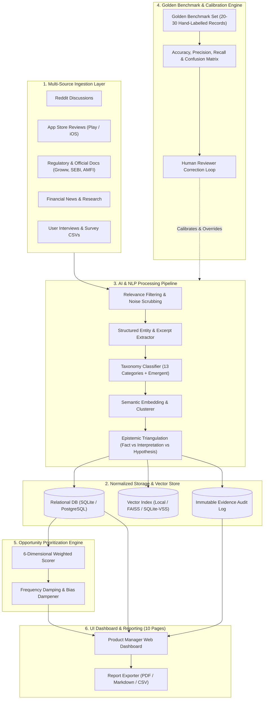
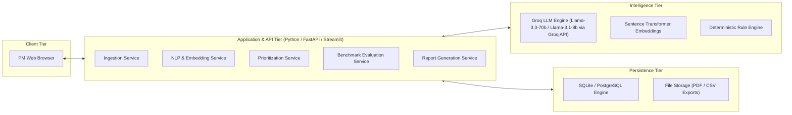
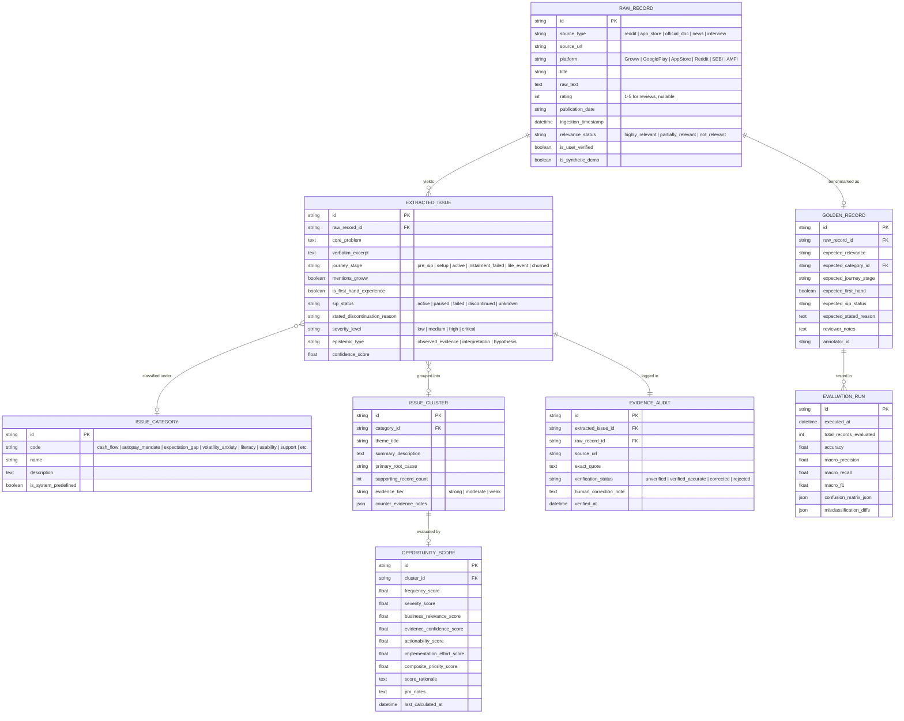
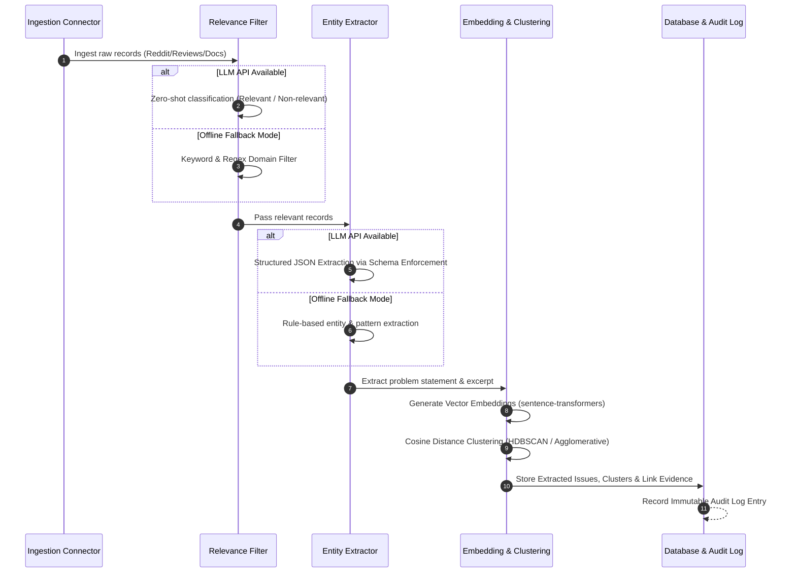
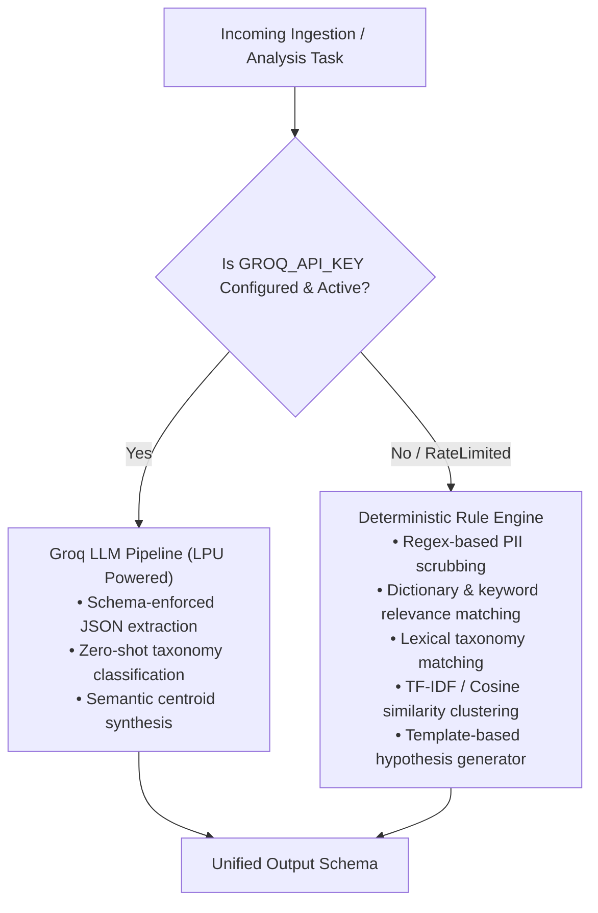
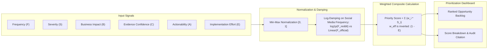
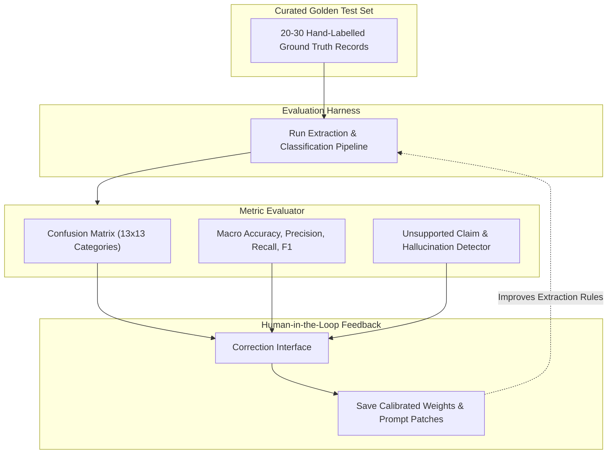
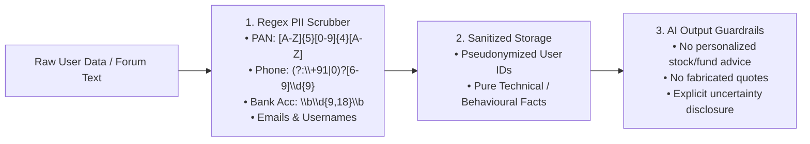

# System Architecture Design: AI Discovery Engine — Groww SIP Continuation Research

> **Document Type:** System Architecture Design Document (ADD)  
> **Target Domain:** WealthTech / Mutual Fund Research / Product Discovery  
> **Target Platform:** Groww (Mutual Funds & Systematic Investment Plans)  
> **Companion Document:** [context.md](file:///c:/Users/kumar/Desktop/New%20folder%20(6)/New%20folder/context.md)  
> **Source PRD:** [prolemstatement.txt](file:///c:/Users/kumar/Desktop/New%20folder%20(6)/New%20folder/prolemstatement.txt)

---

## 1. System Overview & Core Principles

The **AI Discovery Engine** is an evidence-backed intelligence and research platform designed for Product Managers. Its architecture prioritizes **scientific rigor**, **auditable evidence trails**, **deterministic fallback execution**, and **human-in-the-loop validation** over opaque generative responses.



### 1.1 Architectural Tenets
1. **Auditable Evidence Lineage:** No finding, cluster, or score exists without a direct, verifiable link to its raw source excerpt and provenance metadata.
2. **Deterministic Offline Fallback:** If LLM API keys are unavailable, expired, or rate-limited, the system seamlessly transitions to deterministic rule-based algorithms (regex entity extraction, keyword matching, and BM25 search) without crashing.
3. **Hypothesis Neutrality & Bias Mitigation:** Reddit noise and vocal forum complaints are tempered by frequency-damping algorithms and weighted against macro-statistical datasets (SEBI/AMFI).
4. **Zero-PII Privacy Barrier:** Ingestion pipelines automatically scrub Personal Identifiable Information (PII), PAN numbers, bank credentials, and customer IDs before storage.
5. **Human-in-the-Loop Calibration:** AI outputs are treated as probabilistic proposals until validated against a curated Golden Benchmark Dataset.

---

## 2. System Decomposition & Layer Architecture



### 2.1 Layer Responsibilities

| Layer | Primary Responsibilities | Technologies |
|---|---|---|
| **Presentation Tier** | 10 modular views, reactive state management, parameter sliders, human correction UI, and export triggers. | Streamlit / React (Tailwind CSS) |
| **API & Business Logic** | Orchestrates ingestion, runs asynchronous batch jobs, computes scores, and manages audit trails. | Python 3.10+, FastAPI / Streamlit Server |
| **Intelligence Engine** | Performs ultra-fast zero-shot relevance filtering, schema-enforced entity extraction, semantic embeddings, and clustering. | Groq LLM API (`groq` SDK: `llama-3.3-70b-versatile` / `llama-3.1-8b-instant`), `sentence-transformers` |
| **Fallback Engine** | Regex parsing, keyword taxonomies, TF-IDF / BM25 matching, and heuristic scoring when offline. | Python `re`, `scikit-learn` |
| **Storage & Persistence** | Relational integrity, foreign key cascading, vector indexing, and immutable audit logs. | SQLite (Local Dev) $\to$ PostgreSQL (Production) + `sqlite-vss` / `numpy` |

---

## 3. Data Architecture & Relational Schema

The data schema guarantees full traceability from raw ingested text down to prioritized product opportunities and evaluation corrections.



---

## 4. AI & NLP Processing Pipeline



### 4.1 Step 1: Relevance Filtering
- **Input:** Raw ingested text, title, source channel.
- **Criteria:** Retain discussions focused on SIP initiation, mandate setup, AutoPay failures, salary timing, portfolio anxiety, and Groww app workflows. Exclude stock tips, intra-day F&O trades, and unrelated ads.
- **Human Safeguard:** Excluded records are quarantined in an `Excluded Records` view with a 1-click **Restore** mechanism.

### 4.2 Step 2: Structured Entity Extraction (JSON Schema)
The extraction prompt forces structured JSON conforming to the following Pydantic schema:

```python
class ExtractedIssueSchema(BaseModel):
    core_problem: str = Field(description="Single-sentence summary of user problem")
    verbatim_excerpt: str = Field(description="Exact snippet supporting the claim")
    journey_stage: Literal[
        "pre_sip", "setup", "active", "instalment_failed", "life_event", "churned"
    ]
    mentions_groww: bool
    is_first_hand_experience: bool
    sip_status: Literal["active", "paused", "failed", "discontinued", "unknown"]
    stated_discontinuation_reason: Optional[str]
    severity_level: Literal["low", "medium", "high", "critical"]
    epistemic_type: Literal["observed_evidence", "interpretation", "hypothesis"]
    confidence_score: float = Field(ge=0.0, le=1.0)
```

### 4.3 Step 3: Taxonomy Classification (13 Categories + Emergent Themes)
1. Financial Affordability & Cash-Flow Mismatch
2. Unexpected Expenses & Financial Emergencies
3. SIP Payment Failures
4. AutoPay & Mandate Difficulties
5. SIP Modification & Cancellation Difficulties
6. Investment Expectation Mismatch
7. Market Volatility & Investment Anxiety
8. Lack of Investment Understanding
9. Confusing Statements & Portfolio Information
10. App Usability & Navigation
11. Customer Support & Trust
12. Changes in Financial Goals & Responsibilities
13. Other / Unclassified

*Dynamic Emergence Rule:* When cluster distance to all 13 standard category centroids exceeds a cosine distance threshold $\theta > 0.45$, the engine flags an **Emergent Theme** candidate for PM review.

### 4.4 Step 4: Semantic Embeddings & Clustering
- **Embedding Model:** `sentence-transformers/all-MiniLM-L6-v2` (384 dimensions) or API embeddings.
- **Clustering Algorithm:** Agglomerative Hierarchical Clustering with cosine affinity or HDBSCAN.
- **Centroid Synthesis:** For each cluster, Groq LLM summarizes the cluster centroid into a clear PM problem narrative with representative citations.

### 4.5 Step 5: Epistemic Triangulation Engine
Enforces strict separation of knowledge tiers:
- **Observed Evidence:** Unambiguous statements directly made by users or official reports (e.g., *"My bank debited ₹295 penalty for bounce"*).
- **Interpretation:** Inferred mechanisms (e.g., *"User experienced debit date misalignment relative to salary date"*).
- **Hypothesis:** Unverified assumptions (e.g., *"A smart buffer-date notification would have prevented discontinuation"*).

---

## 5. Deterministic Offline Fallback Architecture

To ensure the platform operates reliably in air-gapped environments, CI pipelines, or during API outages, every LLM-dependent stage features a deterministic fallback.



### Fallback Implementation Rules:
1. **Relevance Filtering:** Keyword lexicon check (matching tokens: `sip`, `autopay`, `mandate`, `groww`, `deduction`, `instalment`, `cancelled`).
2. **Entity Extraction:** Regular expression extractors for monetary figures (`₹\d+`), status keywords (`failed`, `cancelled`, `stopped`, `bounced`), and severity indicators.
3. **Clustering:** TF-IDF vectorization + scikit-learn Agglomerative Clustering.
4. **Transparency Banner:** When fallback mode is active, the UI displays an informational badge: `Operating in Deterministic Fallback Mode (Offline)`.

---

## 6. Opportunity Prioritization Engine & Mathematical Formulation

The engine provides an objective, transparent ranking of discovered friction points to prevent emotional decision-making.



### 6.1 Mathematical Formulation

$$\text{Composite Priority Score} = w_{\text{freq}} \tilde{S}_{\text{freq}} + w_{\text{sev}} \tilde{S}_{\text{sev}} + w_{\text{biz}} \tilde{S}_{\text{biz}} + w_{\text{conf}} \tilde{S}_{\text{conf}} + w_{\text{act}} \tilde{S}_{\text{act}} + w_{\text{eff}} (1.0 - \tilde{S}_{\text{eff}})$$

Where:
- $\tilde{S}_i \in [0.0, 1.0]$ are normalized dimension scores.
- Default weights:
  - $w_{\text{biz}} = 0.25$ (Impact on 12-Month SIP Continuation)
  - $w_{\text{sev}} = 0.20$ (Severity of user pain)
  - $w_{\text{act}} = 0.20$ (Product actionability within Groww's scope)
  - $w_{\text{conf}} = 0.15$ (Evidence confidence tier)
  - $w_{\text{freq}} = 0.10$ (Log-damped frequency)
  - $w_{\text{eff}} = 0.10$ (Implementation feasibility)
  - $\sum w_i = 1.0$

### 6.2 Frequency Damping & Anti-Vocal-Minority Dampener
To prevent 50 angry Reddit posts from outweighing an official SEBI or AMFI finding:

$$\tilde{S}_{\text{freq}} = \frac{\ln(1 + N_{\text{reddit}}) + 2.5 \cdot \ln(1 + N_{\text{interviews}}) + 5.0 \cdot \mathbb{I}_{\text{official}}}{\text{Max Scale Factor}}$$

---

## 7. AI Evaluation & Golden Benchmark Architecture



### Evaluation Protocol:
1. **Benchmark Suite:** 25 meticulously verified records across real user interviews, Reddit discussions, Play Store complaints, and SEBI survey excerpts.
2. **Evaluation Metrics:**
   - Classification Accuracy per category.
   - Precision & Recall on `mentions_groww` and `sip_status`.
   - Extraction Fidelity: Verifying that `verbatim_excerpt` is an exact character-for-character substring of `raw_text`.
3. **Inter-Annotator Agreement (IAA):** Cohen's Kappa ($\kappa$) is computed when dual human annotators label records, ensuring labels are statistically consistent.

---

## 8. User Interface Architecture (10 Dedicated Views)

The front-end is organized into 10 purpose-built views designed for PM research productivity:

```mermaid
graph TD
    App["AI Discovery Engine Dashboard"]
    
    App --> P1["Page 1: Research Dashboard (KPIs, Source Breakdown, Status)"]
    App --> P2["Page 2: Source Explorer (Search, Filter, Full Metadata Inspector)"]
    App --> P3["Page 3: AI Analysis (Semantic Clusters, Categories, Triangulation)"]
    App --> P4["Page 4: SIP Discontinuation Analysis (User Journey Funnel Breakdown)"]
    App --> P5["Page 5: Competitive Research (Groww Specific Workflows vs Friction)"]
    App --> P6["Page 6: Research Questions (Evidence Answers to PM Q1-Q6)"]
    App --> P7["Page 7: Opportunity Prioritization (Weighted Scoring Leaderboard)"]
    App --> P8["Page 8: Evaluation & Golden Set (Confusion Matrix, Error Analysis)"]
    App --> P9["Page 9: Evidence Log (Audit Trail, Verbatim Excerpts, CSV/JSON)"]
    App --> P10["Page 10: Report Generator (Automated PM Report in PDF/MD/CSV)"]
```



### Detailed Functional View Breakdown:

1. **Page 1: Research Dashboard:** High-level metrics: total ingested records, breakdown by source type, percentage of relevant records, active problem clusters, and last sync timestamp.
2. **Page 2: Source Explorer:** Full-text searchable data grid with faceted filtering (by source, date, rating, relevance status), excerpt previews, and categorization override controls.
3. **Page 3: AI Analysis:** Visual cluster topology, category distribution charts, evidence count counters, and fact vs. interpretation badges.
4. **Page 4: SIP Discontinuation Analysis:** Journey-stage mapper organizing friction across the 6 investment lifecycle phases:
   - *Pre-SIP $\to$ Mandate Setup $\to$ Active Instalments $\to$ Payment Failure $\to$ Financial Shock $\to$ Churn.*
5. **Page 5: Competitive Research:** Deep dive into Groww-specific features (Groww AutoPay, UPI Mandates, Skip SIP workflow, Step-Up SIP) paired with user-reported friction.
6. **Page 6: Research Questions & Insights:** Direct, evidence-grounded answers to the Six Core PM Discovery Questions (Q1–Q6) with instant citations.
7. **Page 7: Opportunity Prioritization:** Interactive scoring matrix with sliders for weights ($w_i$), dynamic rank updates, rationale tooltips, and PM note fields.
8. **Page 8: Evaluation & Golden Set:** AI benchmark scorecards, interactive confusion matrix heatmap, false-positive drill-down, and benchmark record editor.
9. **Page 9: Evidence Log:** Transparent audit table displaying Record ID, Source URL, Original Snippet, Extracted Claim, Quality Tier, and Verification Status.
10. **Page 10: Report Generator:** 1-click generation of comprehensive PM research dossiers with customizable sections, downloadable as PDF, Markdown, and CSV.

---

## 9. API Specifications & Internal Contracts

### 9.1 Data Ingestion API

#### `POST /api/v1/ingest/batch`
Ingests a collection of records from any supported channel.

```json
{
  "source_type": "app_store",
  "records": [
    {
      "external_id": "gp_rev_98412",
      "platform": "GooglePlay",
      "title": "AutoPay deducted late",
      "text": "My SIP was scheduled for 5th, but Groww attempted debit on 8th when my balance was low. Bank charged ₹295 bounce fee!",
      "rating": 1,
      "publication_date": "2026-10-15T09:30:00Z",
      "source_url": "https://play.google.com/store/apps/details?id=com.nextbillion.groww"
    }
  ]
}
```

### 9.2 Analysis Execution API

#### `POST /api/v1/analysis/process`
Triggers the filtering, extraction, and clustering pipeline for unanalyzed records.

```json
{
  "batch_size": 50,
  "force_recluster": false,
  "confidence_threshold": 0.65
}
```

*Response:*
```json
{
  "status": "success",
  "processed_count": 50,
  "relevant_count": 42,
  "excluded_count": 8,
  "clusters_updated": 7,
  "execution_mode": "llm_enhanced"
}
```

### 9.3 Prioritization & Scoring API

#### `GET /api/v1/opportunities/ranked`
Returns the ranked list of problem clusters based on active dimension weights.

```json
{
  "weights": {
    "frequency": 0.10,
    "severity": 0.20,
    "business_relevance": 0.25,
    "evidence_confidence": 0.15,
    "actionability": 0.20,
    "implementation_effort": 0.10
  }
}
```

---

## 10. Security, Privacy & Compliance Architecture



### 10.1 Data Sanitization & Regulatory Rules
1. **PAN & Bank Detail Masking:** Every ingestion stream passes through regex scrubbers that substitute detected Indian financial identifiers with `[REDACTED_FINANCIAL_ID]`.
2. **Non-Storage of Authentication Artifacts:** No session tokens, cookies, or user credentials are ever stored.
3. **SEBI Advisory Boundary:** The application outputs product opportunity discovery insights for Product Managers. It strictly forbids generating retail investment recommendations, fund ratings, or guaranteed return forecasts.

---

## 11. Codebase Directory Structure

```
├── config/
│   ├── settings.py              # Environment configuration & API key management
│   └── taxonomy.yaml            # 13 default categories & classification schemas
├── data/
│   ├── raw/                     # Raw cached imports (CSV, JSON, sample datasets)
│   ├── golden/                  # 20-30 hand-labelled benchmark records
│   └── app_database.sqlite      # SQLite database file
├── src/
│   ├── __init__.py
│   ├── ingestion/               # Modular ingestion connectors
│   │   ├── base.py              # Ingestion interface
│   │   ├── reddit_collector.py  # Reddit API / manual scraper
│   │   ├── review_collector.py  # Google Play / App Store parser
│   │   ├── doc_collector.py     # Groww, SEBI & AMFI parser
│   │   └── csv_importer.py      # Manual research CSV & interview importer
│   ├── nlp/                     # AI & Intelligence services
│   │   ├── llm_client.py        # Groq LLM client (Groq SDK: Llama 3.3/3.1 JSON mode)
│   │   ├── relevance_filter.py  # Filter relevant vs irrelevant records
│   │   ├── extractor.py         # Entity & complaint extractor
│   │   ├── clusterer.py         # Semantic embedding & HDBSCAN/Agglomerative clustering
│   │   └── fallback_engine.py   # Deterministic offline rule engine
│   ├── models/                  # Pydantic schemas & SQLAlchemy ORM models
│   │   ├── database.py          # Relational DB models (RawRecord, ExtractedIssue, etc.)
│   │   └── schemas.py           # Pydantic validation schemas
│   ├── prioritization/          # Opportunity ranking algorithms
│   │   ├── scorer.py            # 6-dimensional weighted scoring logic
│   │   └── dampener.py          # Vocal minority & frequency damping
│   ├── evaluation/              # AI benchmarking & Golden Set harness
│   │   ├── benchmark_runner.py  # Automated accuracy & confusion matrix calculator
│   │   └── iaa_evaluator.py     # Inter-annotator agreement (Cohen's Kappa)
│   └── reporting/               # Export services
│       ├── report_builder.py    # Generates structured PM research dossier
│       └── exporters.py         # PDF, Markdown, and CSV serializers
├── ui/                          # Presentation Layer (Streamlit / Web Frontend)
│   ├── app.py                   # Main application entry point & router
│   ├── components/              # Reusable UI widgets (cards, metrics, charts, modals)
│   └── views/                   # 10 Dedicated PM Pages
│       ├── page_1_dashboard.py
│       ├── page_2_source_explorer.py
│       ├── page_3_ai_analysis.py
│       ├── page_4_sip_lifecycle.py
│       ├── page_5_competitive_groww.py
│       ├── page_6_research_questions.py
│       ├── page_7_prioritization.py
│       ├── page_8_evaluation_golden.py
│       ├── page_9_evidence_log.py
│       └── page_10_report_generator.py
├── tests/                       # Comprehensive automated tests
│   ├── test_ingestion.py        # Ingestion parsing & deduplication tests
│   ├── test_extraction.py       # Pydantic extraction schema & fallback tests
│   ├── test_scoring.py          # Prioritization scoring math tests
│   └── test_benchmark.py        # Golden set evaluation pipeline tests
├── requirements.txt             # Project dependencies
└── README.md                    # Setup, configuration & quickstart guide
```

---

## 12. Execution, Testing & Migration Strategy

### 12.1 Local Quickstart & Development
1. **Virtual Environment:** Python 3.10+ virtualenv.
2. **Dependency Installation:** `pip install -r requirements.txt` (FastAPI, Streamlit, pandas, pydantic, sentence-transformers, scikit-learn).
3. **Environment Setup:** Copy `.env.example` to `.env` with `GROQ_API_KEY` (e.g. for Groq LPU inference).
4. **Execution:** Launch via `streamlit run ui/app.py`.

### 12.2 Automated Test Suite
- **Unit Tests:** Verify deterministic regex extraction, PII scrubber functionality, and mathematical correctness of opportunity scoring weights.
- **Integration Tests:** Execute end-to-end ingestion $\to$ extraction $\to$ clustering pipeline using mock offline fixtures.
- **Golden Evaluation Test:** Ensure current prompt / fallback performance achieves $\ge 80\%$ accuracy against the 25-record benchmark set.

### 12.3 Production Migration Path
- Transition local SQLite to **PostgreSQL** with zero schema refactoring (SQLAlchemy abstraction).
- Transition local embedding array search to **`pgvector`** for enterprise scalability across $> 100,000$ ingested records.

