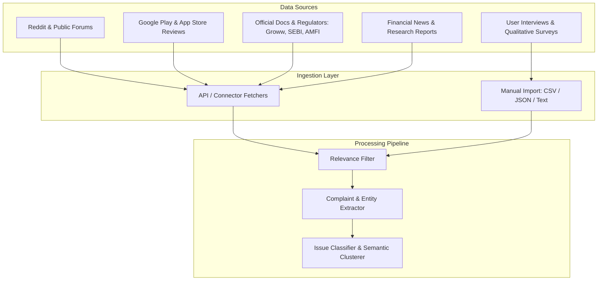
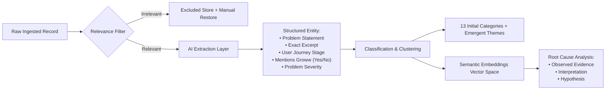
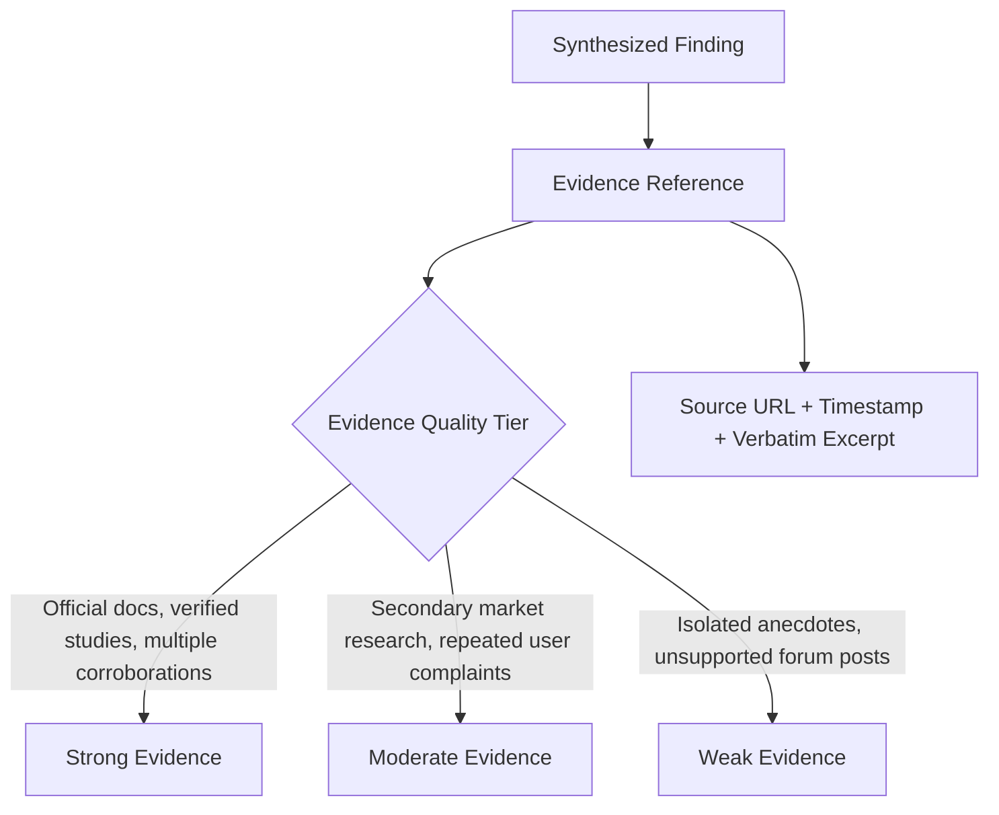
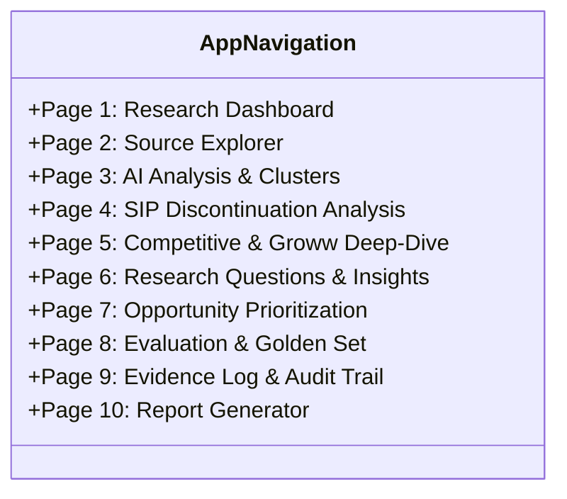

# Project Context: AI Discovery Engine — Groww SIP Continuation Research

> **Document Type:** Project Context & Architecture Specification  
> **Target Domain:** WealthTech / Mutual Fund Investing / Product Discovery  
> **Target Platform:** Groww (India)  
> **Primary User:** Product Manager (PM)  
> **Source PRD:** [prolemstatement.txt](file:///c:/Users/kumar/Desktop/New%20folder%20(6)/New%20folder/prolemstatement.txt)

---

## 1. Executive Summary & Vision

The **AI Discovery Engine** is a specialized Product Discovery and Research system engineered to help Product Managers systematically investigate, analyze, validate, and prioritize user problems surrounding **Systematic Investment Plan (SIP) discontinuation among first-time mutual fund investors**.

Unlike general-purpose conversational chatbots or passive data scrapers, this system functions as an **evidence-backed research assistant**. It synthesizes multi-source qualitative and quantitative data, distinguishes verified facts from speculative opinions, clusters user pain points using semantic embeddings, benchmarks AI extraction accuracy against a curated golden dataset, and scores product intervention opportunities using a multi-dimensional framework.

---

## 2. The Business Problem & Domain Context

### 2.1 The Core Business Metric
- **Target Goal:** Increase the percentage of first-time mutual fund investors whose SIP remains active **12 months** after their inaugural SIP contribution.
- **Operational Definition of "Active SIP":** An SIP is deemed active if **at least one instalment has been successfully processed within the preceding 30 days**.

### 2.2 The Research Challenge
First-time mutual fund investors often face unexpected friction that disrupts recurring investments. However, PMs frequently fall into the trap of confirmation bias (e.g., assuming discontinuation is solely due to cash-flow shortage). 

The system must remain hypothesis-agnostic and systematically test multiple competing root-cause hypotheses:
1. **Cash-Flow Mismatch:** Inability to balance committed SIP dates with salary delays, essential expenditures, and loan repayments.
2. **Payment & Mandate Friction:** AutoPay setup hurdles, NPCI e-mandate rejection, insufficient balance bounce charges, or confusing recovery loops.
3. **Investment Expectation Mismatch:** Disillusionment when market returns do not materialize immediately or short-term volatility causes paper losses.
4. **Market-Related Anxiety & Panic:** Emotional distress and impulse cancellations during market downturns.
5. **Financial Literacy Deficits:** Confusion regarding NAV movements, SIP vs. lump-sum mechanics, portfolio drawdown vs. payment failure.
6. **Shifting Financial Priorities:** Redirection of funds toward life events (weddings, education, emergencies, real estate).
7. **Product Usability & Trust Deficits:** Confusing Groww navigation, lack of transparency in order execution status, or unresponsive customer support.

---

## 3. The Six PM Discovery Questions

All discovery workflows and synthesized findings must directly address six strategic questions:

| ID | Discovery Question | Investigation Scope |
|---|---|---|
| **Q1** | **Why do users begin investing?** | Initial motivations: wealth creation, long-term security, tax saving (ELSS), peer influence, and promotional campaigns. |
| **Q2** | **Why do users struggle to maintain an SIP?** | Systemic frictions: behavioural resistance, financial shocks, operational mandates, and platform UX. |
| **Q3** | **What prevents users from understanding or managing their investments?** | Information architecture: jargon, statement clarity, portfolio tracking, and modification/pause options. |
| **Q4** | **What happens when financial circumstances change?** | Flexibility barriers: job changes, variable income, emergencies, and lack of dynamic SIP adjustment. |
| **Q5** | **Where does Groww contribute to the user experience?** | Platform attribution: isolating Groww app workflows and UI/UX issues from external banking/regulatory failures. |
| **Q6** | **Which product opportunity should be prioritised?** | Strategic prioritization: ranking interventions based on frequency, severity, retention impact, and engineering feasibility. |

---

## 4. Multi-Source Ingestion Engine

The system supports automated ingestion, permitted public scrapers, API connectors, and manual CSV/transcript uploads across five distinct channels:

### Ingestion Source Details & Schemas:
1. **Reddit & Community Discussions:**
   - *Target Keywords:* "Groww SIP failed", "Groww AutoPay issue", "Unable to continue SIP", "SIP insufficient balance", "Why did you stop your SIP?", etc.
   - *Metadata Captured:* Title, body text, permalink, publication timestamp, subreddit, user context.
2. **App Store Reviews (Google Play & Apple App Store):**
   - *Metadata Captured:* Review text, star rating, author/review ID, app version, platform, date.
   - *Balance Requirement:* Ingest both 1-2 star complaints and 4-5 star positive feedback to eliminate negativity bias.
3. **Official Documentation & Industry Benchmarks:**
   - *Groww Documentation:* Official troubleshooting guides, mandate steps, FAQs.
   - *SEBI & AMFI Reports:* Industry-level SIP discontinuation ratios, monthly flows, macro investor survey statistics.
   - *Handling Rule:* Official reports establish whether a mechanism exists or provide macroeconomic baselines, but do not prove individual platform failure rates.
4. **News & Industry Articles:**
   - Articles covering retail investor trends, fintech retention, and macro market sentiment.
5. **Primary User Research (Interviews & Surveys):**
   - Manual upload for CSVs, interview transcripts, and field notes.
   - Tagged with anonymous IDs, investment experience level (first-time vs. seasoned), and SIP status (Active, Paused, Cancelled).
   - Strict privacy safeguards: Zero PII, PAN numbers, bank account numbers, or real portfolio screenshots.

---

## 5. AI Analysis & Intelligence Layer

### 5.1 Relevance Filtering
- Categorizes records into: **Highly Relevant**, **Partially Relevant**, or **Not Relevant**.
- Filters out generic trading discussions (options/crypto), stock picks, and ads.
- Includes a manual override toggle allowing researchers to restore false-negative exclusions.

### 5.2 Complaint & Evidence Extraction
Extracts structured attributes from raw text:
- **Core Problem:** Concisely phrased issue.
- **Supporting Excerpt:** Verbatim quote from source.
- **Experience Authenticity:** Distinguishes first-hand lived experience from hypothetical questions.
- **Platform Specificity:** Explicitly flags whether Groww is named.
- **SIP Status:** Active, Paused, Discontinued, or Unknown.
- **Stated Discontinuation Reason:** Explicitly noted vs. unstated.
- **Severity Rating:** Minor inconvenience vs. catastrophic churn trigger.

### 5.3 Initial Classification Taxonomy (13 Categories)
1. Financial Affordability & Cash-Flow Mismatch
2. Unexpected Expenses & Financial Emergencies
3. SIP Payment Failures
4. AutoPay & Mandate Difficulties
5. SIP Modification & Cancellation Difficulties
6. Investment Expectation Mismatch
7. Market Volatility & Investment Anxiety
8. Lack of Investment Understanding
9. Confusing Statements & Portfolio Information
10. App Usability & Navigation
11. Customer Support & Trust
12. Changes in Financial Goals & Responsibilities
13. Other / Unclassified (Triggers emergent theme discovery)

### 5.4 Semantic Clustering & Nuance Separation
Semantic embeddings distinguish superficially similar complaints into precise root causes:
- *Debit-Date Mismatch* (salary arrives after debit date) $\neq$ *Absolute Liquidity Crisis* (loss of income).
- *Bank-Side Mandate Failure* (NPCI/bank downtime) $\neq$ *Groww UI/Recovery Workflow Breakage*.

### 5.5 Epistemic Triangulation
The AI strictly enforces clear ontological boundaries:
- **Observed Evidence:** What the user or document explicitly stated.
- **Interpretation:** The AI's or researcher's inference of the underlying mechanism.
- **Hypothesis:** A testable statement requiring further validation.

---

## 6. Evidence Quality & Auditability Framework

Every claim and finding is linked to an auditable trail:

### Contradiction Handling
When data sources disagree (e.g., AMFI statistics report low aggregate cancellation rates while forum reviews complain of rampant mandate rejections), the system preserves both datasets and flags the divergence rather than forcing an artificial consensus.

---

## 7. Opportunity Prioritization Engine

To prevent PMs from blindly chasing vocal minorities (e.g., forum chatter), problem themes are evaluated using a 6-dimensional scoring matrix:

$$\text{Priority Score} = \sum_{i} w_i \times S_i$$

### Scoring Dimensions:
1. **Frequency ($S_{\text{freq}}$):** Volume of occurrences across diverse datasets.
2. **Severity ($S_{\text{sev}}$):** Intensity of user frustration or financial friction.
3. **Business Relevance ($S_{\text{biz}}$):** Direct correlation with 12-month SIP continuation.
4. **Evidence Confidence ($S_{\text{conf}}$):** Reliability, corroboration, and data quality tier.
5. **Actionability ($S_{\text{act}}$):** Feasibility of addressing the issue via product changes within Groww's sphere of control.
6. **Implementation Effort ($S_{\text{eff}}$):** Engineering, compliance, and design complexity (inversely scored).

Researchers can adjust dimension weights ($w_i$) dynamically through the UI.

---

## 8. AI Evaluation & Human-in-the-Loop Golden Set

The system enforces rigorous validation rather than assuming LLM outputs are factual:

- **Golden Benchmark Dataset:** A curated test set of 20–30 human-labelled representative records.
- **Evaluation Metrics:**
  - Classification Accuracy, Precision, Recall, and F1-score across categories.
  - Multi-class Confusion Matrix.
  - Identification of false positives, missed critical issues, and unsupported AI inferences.
- **Human Correction Loop:** Researchers can correct AI misclassifications, re-run evaluations, compare before-and-after accuracy deltas, and export the calibrated dataset.

---

## 9. Application UI Architecture (10 Modules)

The application provides 10 dedicated views designed for PM research workflows:

1. **Page 1: Research Dashboard:** Macro KPIs (total ingested records, source distributions, relevance ratio, active clusters, verification health).
2. **Page 2: Source Explorer:** Searchable, filterable table of all raw sources with excerpt inspect, categorization override, and export.
3. **Page 3: AI Analysis:** Visual cluster map, category drill-down, supporting evidence counts, and counter-evidence flags.
4. **Page 4: SIP Discontinuation Analysis:** Journey-stage mapper:
   - *Pre-SIP $\to$ Setup & Mandate $\to$ Active Contributions $\to$ Instalment Failure $\to$ Life Event Shock $\to$ Discontinuation / Churn.*
5. **Page 5: Competitive Research:** Focused audit of Groww's existing workflows, documented failure modes, and user friction points.
6. **Page 6: Research Questions & Insights:** Direct, evidence-backed answers to the Six PM Discovery Questions (Q1–Q6).
7. **Page 7: Opportunity Prioritization:** Interactive weighted scoring leaderboard with rationale cards and PM note-taking.
8. **Page 8: Evaluation & Golden Set:** AI accuracy dashboard, confusion matrix, error analysis, and benchmark record editor.
9. **Page 9: Evidence Log:** Transparent, exportable (CSV/JSON), shareable audit trail showing the provenance of every claim.
10. **Page 10: Report Generator:** Comprehensive research report builder exporting to PDF, Markdown, and CSV formats.

---

## 10. Technical Specifications & Architecture

### 10.1 Recommended Technology Stack
- **Frontend:** Streamlit / React (Tailwind CSS) for responsive, clean PM dashboards.
- **Backend:** Python (FastAPI or Streamlit core) for data manipulation, scoring algorithms, and API routing.
- **Data Persistence:** SQLite (local zero-configuration MVP) with migration-ready schemas for PostgreSQL.
- **Data Manipulation:** `pandas`, `numpy`, `pydantic`.
- **AI & NLP:**
  - **Primary LLM:** Groq LLM API (e.g. `llama-3.3-70b-versatile` for deep extraction & clustering, `llama-3.1-8b-instant` for ultra-fast relevance filtering) using LPU inference for high-throughput, low-latency JSON extraction, configured via `GROQ_API_KEY`.
  - Configurable multi-provider interface (Groq primary, extensible to other providers).
  - Semantic embeddings (`sentence-transformers` or vector embeddings) with local vector store / cosine similarity.
- **Offline / Deterministic Fallback Mode:**
  - If no Groq LLM API key (`GROQ_API_KEY`) is configured, the application **must not crash**. It automatically reverts to rule-based keyword extraction, regex pattern matching, and manual classification modes.

### 10.2 Security, Privacy & Integrity Guardrails
- **No PII / Financial Data:** Never store PAN numbers, bank credentials, account balances, or un-anonymized names.
- **API Key Security:** Store credentials strictly in `.env` files; never expose keys to the client UI or bundle them in builds.
- **Anti-Hallucination Protections:**
  - The system must never fabricate quotes, survey counts, or Reddit posts.
  - Prohibit generalizing SEBI nationwide data as Groww-specific metrics.
  - Prohibit treating Reddit comment frequency as representative of India's total investor population.
  - Restrict advice generation: do not generate investment recommendations, fund ratings, or financial predictions.

---

## 11. Final Deliverables Checklist

- [ ] **Working Application:** Fully functional interactive web application.
- [ ] **Data Ingestion System:** Modular connectors (Reddit, reviews, docs, CSV).
- [ ] **Analysis Pipeline:** Relevance filtering, entity extraction, semantic clustering.
- [ ] **Prioritization Module:** Configurable 6-dimension scoring framework.
- [ ] **Golden Evaluation Module:** 20–30 record benchmark dataset, confusion matrix, correction loop.
- [ ] **Evidence Audit Log:** Searchable provenance log with CSV/JSON export.
- [ ] **Report Generator:** Multi-format exporter (PDF, Markdown, CSV).
- [ ] **Demonstration Dataset:** Preloaded sample data clearly identifying real vs. synthetic demo records.
- [ ] **Automated Tests:** Unit test suite covering parsing, scoring, classification, and deterministic fallback.
- [ ] **Setup Guide (`README.md`):** Clear execution instructions and environment configuration guide.

