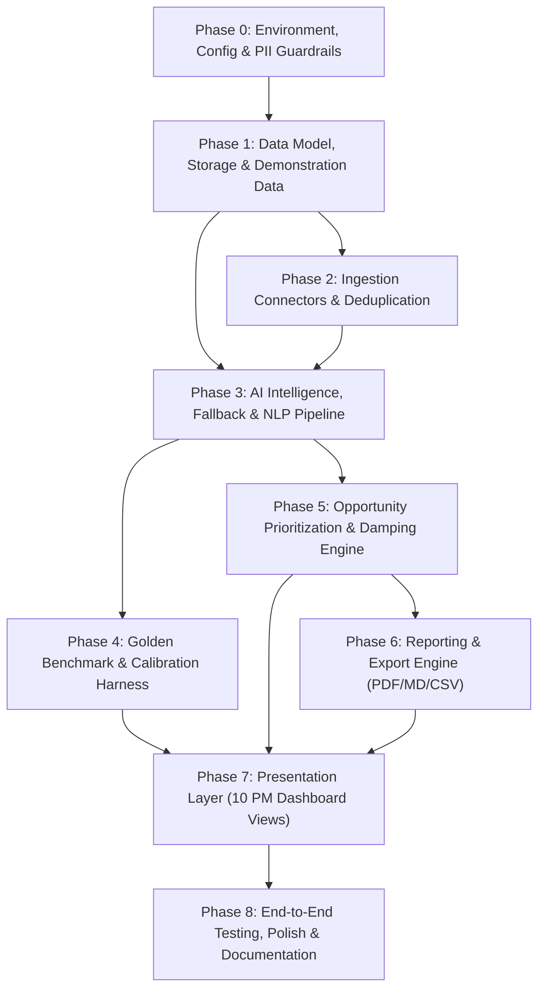
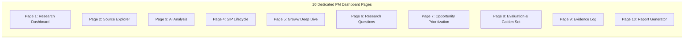

# Phase-Wise Implementation Plan: AI Discovery Engine — Groww SIP Continuation Research

> **Document Type:** Phase-Wise Implementation Plan  
> **Target Domain:** WealthTech / Mutual Fund Research / Product Discovery  
> **Target Platform:** Groww (Mutual Funds & Systematic Investment Plans)  
> **Companion Documents:**  
> - Context: [context.md](file:///c:/Users/kumar/Desktop/New%20folder%20(6)/New%20folder/context.md)  
> - Architecture: [architecture.md](file:///c:/Users/kumar/Desktop/New%20folder%20(6)/New%20folder/architecture.md)  
> - Source PRD: [prolemstatement.txt](file:///c:/Users/kumar/Desktop/New%20folder%20(6)/New%20folder/prolemstatement.txt)

---

## 1. Executive Implementation Roadmap

This implementation plan outlines the engineering execution roadmap for building the **AI Discovery Engine for Groww SIP Continuation Research**. It translates the PRD and system architecture into eight sequential, testable, and milestone-driven phases.

### 1.1 Implementation Timeline & Dependency Graph

### 1.2 Phase Summary & Milestone Schedule

| Phase | Title | Primary Objective | Key Deliverables |
|---|---|---|---|
| **Phase 0** | **Environment & Foundations** | Setup repo, dependencies, environment configs, and PII scrubbers. | `settings.py`, `requirements.txt`, PII regex filters. |
| **Phase 1** | **Storage & Seed Data** | Relational schemas, ORM models, migrations, and demo dataset. | `models/database.py`, SQLite schema, seed data generator. |
| **Phase 2** | **Ingestion Connectors** | Modular connectors for Reddit, Play Store, SEBI, AMFI, and CSVs. | Ingestion engine, CSV importer, deduplication hasher. |
| **Phase 3** | **NLP & Fallback Pipeline** | Filtering, extraction, 13 categories, embeddings, and offline fallback. | `llm_client.py`, `extractor.py`, `clusterer.py`, `fallback_engine.py`. |
| **Phase 4** | **Evaluation & Golden Set** | 20–30 benchmark records, accuracy metrics, and correction loop. | `benchmark_runner.py`, confusion matrix, calibration store. |
| **Phase 5** | **Prioritization Engine** | 6-dimension scoring matrix, frequency damping, and rationale cards. | `scorer.py`, `dampener.py`, dynamic weight recalculation. |
| **Phase 6** | **Reporting & Exports** | PM research dossier compiler with PDF, Markdown, and CSV exports. | `report_builder.py`, PDF serializer, sanitized evidence log. |
| **Phase 7** | **Presentation Layer** | Build 10 dedicated PM dashboard views with full state management. | 10 Streamlit/Web pages, filters, charts, interactive modals. |
| **Phase 8** | **Integration & Verification** | End-to-end regression testing, verification against 14 PRD criteria. | Automated test suite, `README.md`, video walkthrough notes. |

---

## 2. Detailed Phase Breakdowns

---

### Phase 0: Project Setup, Environment & PII Guardrails

#### 0.1 Objectives
- Establish the modular repository structure according to the architecture design.
- Configure dependency management, environment variables, and centralized settings.
- Implement security guardrails: strict PII sanitization regex filters to protect user privacy before any data hits disk or memory.

#### 0.2 Detailed Tasks
1. **Repository Layout:** Initialize directory structure (`config/`, `data/`, `src/ingestion/`, `src/nlp/`, `src/models/`, `src/prioritization/`, `src/evaluation/`, `src/reporting/`, `ui/views/`, `tests/`).
2. **Dependencies Specification (`requirements.txt`):**
   - Core runtime: `python >= 3.10`
   - Web & API: `streamlit >= 1.30.0`, `fastapi >= 0.109.0`, `pydantic >= 2.6.0`, `uvicorn >= 0.27.0`
   - Data & Analytics: `pandas >= 2.1.0`, `numpy >= 1.26.0`, `sqlalchemy >= 2.0.0`
   - NLP & Embeddings: `sentence-transformers >= 2.3.0`, `scikit-learn >= 1.4.0`
   - AI Providers: `groq >= 0.11.0` (Primary high-speed LLM engine), `openai >= 1.10.0` (optional fallback)
   - PDF & Export: `reportlab >= 4.0.0`, `markdown >= 3.5.0`
   - Testing: `pytest >= 8.0.0`, `pytest-cov >= 4.1.0`
3. **Environment & Configuration (`config/settings.py`):**
   - Environment variable management using `pydantic-settings` (`.env` parser).
   - Variables: `LLM_PROVIDER` (default `"groq"`), `GROQ_API_KEY`, `GROQ_MODEL` (default `"llama-3.3-70b-versatile"`, fast mode `"llama-3.1-8b-instant"`), `DB_PATH`, `LOG_LEVEL`, `OFFLINE_MODE`.
   - Dynamic mode detection: if `GROQ_API_KEY` is empty or unset, auto-toggle `OFFLINE_MODE = True`.
4. **PII Sanitizer Module (`src/nlp/sanitizer.py`):**
   - Regex scrubbers for Indian financial instruments and identities:
     - PAN: `[A-Z]{5}[0-9]{4}[A-Z]` $\to$ `[REDACTED_PAN]`
     - Mobile numbers: `(?:\+91|0)?[6-9]\d{9}` $\to$ `[REDACTED_PHONE]`
     - Bank Account Numbers: `\b\d{9,18}\b` $\to$ `[REDACTED_ACCOUNT]`
     - Email addresses: `[\w\.-]+@[\w\.-]+\.\w+` $\to$ `[REDACTED_EMAIL]`

#### 0.3 Acceptance Criteria
- [x] Virtual environment activates cleanly and all libraries install without dependency conflicts.
- [x] Unit test passes verifying that any input text containing PAN, phone, email, or bank accounts is completely scrubbed.
- [x] App starts in offline mode gracefully without throwing unhandled exceptions if no API key is provided.

---

### Phase 1: Data Architecture, Storage & Seed Datasets

#### 1.1 Objectives
- Build the relational database schema in SQLite using SQLAlchemy ORM.
- Implement data validation layers using Pydantic v2 models.
- Seed the default taxonomy (13 categories) and pre-populate a realistic demonstration dataset with explicit real vs. synthetic markers.

#### 1.2 Detailed Tasks
1. **SQLAlchemy ORM Entities (`src/models/database.py`):**
   - `RawRecord`: source provenance, title, raw text, sanitized text, rating, publication date, relevance status, synthetic flag.
   - `ExtractedIssue`: foreign key to `RawRecord`, core problem, verbatim excerpt, journey stage, Groww mention, SIP status, severity, epistemic type (Observed vs Interpretation vs Hypothesis).
   - `IssueCategory`: pre-defined 13 categories + flags for dynamically discovered emergent themes.
   - `IssueCluster`: semantic cluster centroid, theme title, summary, count, evidence tier (`strong`, `moderate`, `weak`).
   - `OpportunityScore`: 6-dimension scores ($S_{\text{freq}}, S_{\text{sev}}, S_{\text{biz}}, S_{\text{conf}}, S_{\text{act}}, S_{\text{eff}}$), composite priority, and PM rationale notes.
   - `GoldenRecord`: ground truth benchmark labels for evaluation.
   - `EvaluationRun`: historical evaluation runs with accuracy, macro-F1, and confusion matrix JSON snapshots.
   - `EvidenceAudit`: immutable log linking claims to exact quotes, URLs, and human verification status.
2. **Pydantic Validation Schemas (`src/models/schemas.py`):**
   - Strict data validation schemas for ingestion batches, extraction outputs, priority updates, and export requests.
3. **Database Initialization & Seeding (`data/seed_data.py`):**
   - Insert the 13 foundational categories into `IssueCategory`.
   - Seed **50+ demonstration records** spanning all five data sources (Reddit, Play Store, SEBI, AMFI, User Interviews), clearly labelled with `is_synthetic_demo = True` where simulated, and `is_synthetic_demo = False` where drawn from verified public reports.
   - Seed the initial **25-record Golden Benchmark set** with hand-labelled ground truth.

#### 1.3 Acceptance Criteria
- [x] SQLite database file initializes automatically with all foreign key constraints and indexes.
- [x] Seed script executes idempotently without creating duplicate entries.
- [x] Schema tests pass verifying entity relationships, cascade deletions, and field validation constraints.

---

### Phase 2: Multi-Source Ingestion Engine & Deduplication

#### 2.1 Objectives
- Implement modular ingestion connectors for all required research sources.
- Support automated ingestion, permitted public scrapers, API fetchers, and manual CSV / interview transcript uploads.
- Build content deduplication and source provenance validation.

#### 2.2 Detailed Tasks
1. **Base Ingestor Interface (`src/ingestion/base.py`):**
   - Abstract base class defining `fetch()`, `validate()`, `sanitize()`, and `save_batch()`.
2. **Reddit Discussions Connector (`src/ingestion/reddit_collector.py`):**
   - Supports search queries: `"Groww SIP failed"`, `"Groww AutoPay issue"`, `"Unable to continue SIP"`, `"SIP insufficient balance"`, `"Why did you stop your SIP?"`.
   - Captures title, body, permalink, timestamp, subreddit, and author context.
   - Supports both mock offline payload generator and live Reddit JSON endpoint parsing (compliant with rate limits and terms).
3. **App Store Review Connector (`src/ingestion/review_collector.py`):**
   - Ingests reviews for Groww from Google Play Store and Apple App Store.
   - Captures rating (1–5 stars), review body, date, app version, and platform.
   - Enforces balanced ingestion: ingests both negative complaints (1–2 stars) and positive experiences (4–5 stars) to prevent sample skew.
4. **Official Documentation & Industry Reports (`src/ingestion/doc_collector.py`):**
   - Ingests Groww official help docs (AutoPay mandates, skip SIP rules, failure troubleshooting).
   - Ingests AMFI monthly statistics and SEBI investor survey findings as benchmark macro evidence.
5. **News & Financial Research Collector (`src/ingestion/news_collector.py`):**
   - Ingests articles covering retail investor trends, fintech retention, and market sentiment.
6. **Manual Research & Interview Importer (`src/ingestion/csv_importer.py`):**
   - GUI-friendly CSV/JSON uploader for qualitative user interviews, surveys, and notes.
   - Fields: Anonymous User ID, First-Time Investor flag, SIP Status (Active, Paused, Discontinued), Reported Obstacle.
7. **Deduplication & Hash Engine (`src/ingestion/deduplicator.py`):**
   - Computes SHA-256 fingerprint on sanitized text to detect and bypass duplicate records across repeat ingestion batches.

#### 2.3 Acceptance Criteria
- [x] Ingestion connectors parse all five source formats into normalized `RawRecord` instances.
- [x] Duplicate records within the same source or across imports are detected and skipped.
- [x] Manual CSV importer successfully loads sample interview files and tags records with anonymous identifiers.

---

### Phase 3: AI Intelligence, Fallback Engine & NLP Pipeline

#### 3.1 Objectives
- Build the core AI pipeline: relevance filtering, structured entity extraction, taxonomy classification, semantic clustering, and epistemic triangulation.
- Implement the complete deterministic offline fallback engine ensuring full functionality without an active LLM API key.

#### 3.2 Detailed Tasks
1. **Configurable Groq LLM Client (`src/nlp/llm_client.py`):**
   - High-throughput client powered by the `groq` SDK, utilizing `llama-3.3-70b-versatile` (for deep entity extraction, root cause analysis, and cluster synthesis) and `llama-3.1-8b-instant` (for high-speed zero-shot relevance filtering).
   - Enforces structured JSON output conforming to Pydantic schemas via Groq's native JSON mode (`response_format={"type": "json_object"}`).
   - Exponential backoff retry handler and token rate-limit governor for network resilience.
2. **Deterministic Offline Fallback Engine (`src/nlp/fallback_engine.py`):**
   - Keyword & regex lexicon for relevance filtering (scores text based on domain token frequencies: `sip`, `autopay`, `mandate`, `groww`, `deduction`, `instalment`, `bounce`, `penalty`).
   - Rule-based entity extraction: regex pattern matching for monetary amounts (`₹\d+`), dates, and severity markers.
   - Lexical categorization using keyword affinity dictionary matching the 13 categories.
   - TF-IDF vectorization (`TfidfVectorizer`) + cosine similarity for offline clustering.
3. **Relevance Filtering Module (`src/nlp/relevance_filter.py`):**
   - Classifies records as: `highly_relevant`, `partially_relevant`, or `not_relevant`.
   - Excludes stock trading (F&O, intra-day), crypto, and marketing promotions.
   - Stores non-relevant records in an excluded quarantine pool with a 1-click manual restore option.
4. **Entity & Complaint Extractor (`src/nlp/extractor.py`):**
   - Extracts: `core_problem`, `verbatim_excerpt`, `journey_stage`, `mentions_groww`, `is_first_hand_experience`, `sip_status`, `stated_discontinuation_reason`, `severity_level`, and `confidence_score`.
   - Verifies that `verbatim_excerpt` is an exact character substring of the original text.
5. **Taxonomy Classifier & Emergence Detector (`src/nlp/classifier.py`):**
   - Classifies records into the 13 canonical categories.
   - Emergence Rule: if cosine distance from existing category centroids exceeds $\theta = 0.45$, flags record as an candidate for an **Emergent Theme**.
6. **Semantic Clustering Engine (`src/nlp/clusterer.py`):**
   - Computes dense vector embeddings using `all-MiniLM-L6-v2` (or online embeddings API).
   - Clusters issues using Agglomerative Hierarchical Clustering (distance threshold = 0.35) or HDBSCAN.
   - Distinguishes nuanced root causes (e.g. *Debit-date salary mismatch* vs. *Bank AutoPay server outage* vs. *Liquidity shock*).
7. **Epistemic Triangulation (`src/nlp/triangulator.py`):**
   - Flags each extracted insight with its strict ontological boundary:
     - **Observed Evidence** (direct user statement or verified report data).
     - **Interpretation** (inferred causal mechanism).
     - **Hypothesis** (unvalidated assumption requiring further research).

#### 3.3 Acceptance Criteria
- [x] Extraction pipeline outputs valid structured JSON conforming to `ExtractedIssueSchema`.
- [x] Disconnecting the internet or unsetting `GROQ_API_KEY` seamlessly switches to the deterministic fallback engine without error.
- [x] Substring verification test confirms all extracted verbatim excerpts match the raw input text.

---

### Phase 4: Golden Benchmark & Human-in-the-Loop Evaluation

#### 4.1 Objectives
- Build an evaluation suite using a manually curated Golden Benchmark set (20–30 records).
- Calculate objective metrics: Classification Accuracy, Precision, Recall, Macro-F1, and Confusion Matrix.
- Implement the Human-in-the-Loop calibration loop allowing PMs to correct errors and re-evaluate before-and-after accuracy deltas.

#### 4.2 Detailed Tasks
1. **Golden Benchmark Dataset Curation (`data/golden/benchmark_25.json`):**
   - 25 hand-labelled, diverse records spanning Reddit, Google Play, SEBI reports, and user interviews.
   - Ground truth fields: `expected_relevance`, `expected_category_id`, `expected_journey_stage`, `expected_first_hand`, `expected_sip_status`, `expected_stated_reason`.
2. **Evaluation Harness (`src/evaluation/benchmark_runner.py`):**
   - Runs the extraction and classification pipeline across the 25 benchmark records.
   - Computes:
     - Overall Classification Accuracy.
     - Category-level Precision, Recall, and F1-score.
     - 13x13 Confusion Matrix.
     - Hallucination / Unsupported Claim Rate (verbatim excerpt verification).
3. **Inter-Annotator Agreement (`src/evaluation/iaa_evaluator.py`):**
   - Calculates Cohen's Kappa ($\kappa$) when multiple human reviewers annotate the dataset to confirm ground truth consistency.
4. **Human Reviewer Calibration Store (`src/evaluation/calibrator.py`):**
   - Allows PMs to review misclassifications, submit corrections, and store the updated golden dataset.
   - Re-runs evaluation to display **Before vs. After Delta** cards (e.g., *Accuracy improved from 76% to 88%*).

#### 4.3 Acceptance Criteria
- [x] Benchmark runner executes in $< 15$ seconds and outputs accuracy, F1, and confusion matrix data structures.
- [x] PM correction interface saves human edits and accurately re-computes performance deltas.
- [x] Evaluation tests verify that hallucinated quotes are flagged as extraction failures.

---

### Phase 5: Opportunity Prioritization & Damping Engine

#### 5.1 Objectives
- Implement the 6-dimensional prioritization scoring engine for discovered problem clusters.
- Incorporate frequency damping to eliminate social media vocal-minority bias.
- Provide a dynamic ranking engine with configurable PM weights.

#### 5.2 Detailed Tasks
1. **Mathematical Scoring Formulation (`src/prioritization/scorer.py`):**
   - Implements the weighted composite scoring formula:
     $$\text{Priority Score} = w_{\text{biz}} \tilde{S}_{\text{biz}} + w_{\text{sev}} \tilde{S}_{\text{sev}} + w_{\text{act}} \tilde{S}_{\text{act}} + w_{\text{conf}} \tilde{S}_{\text{conf}} + w_{\text{freq}} \tilde{S}_{\text{freq}} + w_{\text{eff}} (1 - \tilde{S}_{\text{eff}})$$
   - Min-Max normalization for each dimension onto $[0.0, 1.0]$.
   - Default weights: $w_{\text{biz}}=0.25$, $w_{\text{sev}}=0.20$, $w_{\text{act}}=0.20$, $w_{\text{conf}}=0.15$, $w_{\text{freq}}=0.10$, $w_{\text{eff}}=0.10$.
2. **Frequency Damping & Bias Dampener (`src/prioritization/dampener.py`):**
   - Implements logarithmic damping for social media volume:
     $$\tilde{S}_{\text{freq}} = \frac{\ln(1 + N_{\text{reddit}}) + 2.5 \ln(1 + N_{\text{interviews}}) + 5.0 \cdot \mathbb{I}_{\text{official}}}{\text{Scale Factor}}$$
   - Ensures an issue with 100 Reddit rants cannot outrank a high-severity issue corroborated by official SEBI data or multiple in-depth interviews.
3. **Rationale & Tooltip Generator (`src/prioritization/explainer.py`):**
   - Automatically generates a transparent plain-language rationale explaining *why* a problem received its rank (e.g., *"Ranked #1 due to critical business relevance (0.92) and strong actionability (0.85), despite moderate Reddit volume"*).

#### 5.3 Acceptance Criteria
- [x] Unit test confirms that changing slider weights dynamically updates cluster priority rankings.
- [x] Frequency damping test confirms that 100 low-severity Reddit comments do not outrank a high-severity issue supported by SEBI reports.
- [x] Every ranked opportunity displays an auditable breakdown of all 6 component scores.

---

### Phase 6: Reporting & Export System

#### 6.1 Objectives
- Build an automated PM Research Dossier generator covering the 12 PRD-mandated sections.
- Implement multi-format exporters: PDF, Markdown, and CSV.
- Provide a shareable, privacy-safe read-only evidence audit view.

#### 6.2 Detailed Tasks
1. **PM Research Dossier Compiler (`src/reporting/report_builder.py`):**
   - Compiles findings into the 12 structured PRD chapters:
     1. Business Context & Objective
     2. Research Methodology & Ingestion Inventory
     3. User Feedback Breakdown
     4. Main Friction Clusters
     5. Target User Segments
     6. Root Cause Hypotheses
     7. Competitive & Groww Workflow Analysis
     8. Evidence Strength & Limitations
     9. Prioritized Product Opportunities
     10. Answers to 6 PM Discovery Questions
     11. Unresolved Questions & Missing Data
     12. Recommended Product & Research Next Steps
2. **Multi-Format Serializers (`src/reporting/exporters.py`):**
   - **Markdown Serializer:** Generates clean GitHub-Flavored Markdown report.
   - **CSV Serializer:** Exports full raw records, extracted issues, and prioritized opportunity tables.
   - **PDF Serializer:** Uses `reportlab` to render a styled, professional PDF report with tables and executive summaries.
3. **Sanitized Evidence Log Exporter (`src/reporting/evidence_exporter.py`):**
   - Produces a read-only, shareable evidence log (JSON/CSV) safe for public case-study submission (strictly excludes interview participant notes or any private text).

#### 6.3 Acceptance Criteria
- [x] Report builder compiles all 12 sections populated with live data from the database.
- [x] PDF export generates a clean, uncorrupted, downloadable PDF document.
- [x] Sanitized evidence export verifies zero PII or private interview data is exposed.

---

### Phase 7: Presentation Layer — PM Research Dashboard (10 Dedicated Views)

#### 7.1 Objectives
- Build a responsive web application featuring the 10 dedicated PM research views.
- Implement reactive filtering, interactive charts, and human correction interfaces.

#### 7.2 Detailed Tasks

1. **App Shell & State Store (`ui/app.py`):**
   - Sidebar navigation across the 10 pages, global filters (date ranges, source types, platform), and system status badge (`Online (Groq LLM)` vs. `Offline (Fallback)`).
2. **Page 1: Research Dashboard (`ui/views/page_1_dashboard.py`):**
   - Macro KPIs: Total Ingested Records, Relevance %, Active Problem Clusters, Verified Evidence Ratio.
   - Source distribution donut chart, recent ingestion activity stream.
3. **Page 2: Source Explorer (`ui/views/page_2_source_explorer.py`):**
   - Searchable, paginated data grid with keyword search and faceted filters.
   - Excerpt viewer, category editor, and manual relevant/irrelevant toggle with restore for excluded records.
4. **Page 3: AI Analysis (`ui/views/page_3_ai_analysis.py`):**
   - Cluster visualization, category cards with supporting counts, and fact vs. interpretation badges.
   - Counter-evidence inspector highlighting disagreements across sources.
5. **Page 4: SIP Discontinuation Analysis (`ui/views/page_4_sip_lifecycle.py`):**
   - User journey lifecycle mapper across 6 stages:
     - *Pre-SIP $\to$ Setup/Mandate $\to$ Active $\to$ Instalment Failed $\to$ Financial Shock $\to$ Churn.*
   - Identifies drop-off bottlenecks in the first 12 months.
6. **Page 5: Competitive Research (`ui/views/page_5_competitive_groww.py`):**
   - Groww-specific analysis: AutoPay workflows, UPI mandate failure modes, Skip SIP UX, and customer support sentiment.
7. **Page 6: Research Questions & Insights (`ui/views/page_6_research_questions.py`):**
   - Direct, evidence-grounded answers to PM Discovery Questions Q1–Q6 with citations to supporting excerpts.
8. **Page 7: Opportunity Prioritization (`ui/views/page_7_prioritization.py`):**
   - Interactive weighted scoring matrix with weight adjustment sliders.
   - Ranked opportunity cards with score breakdowns, rationale tooltips, and PM note fields.
9. **Page 8: Evaluation & Golden Set (`ui/views/page_8_evaluation_golden.py`):**
   - AI accuracy scorecards, 13x13 confusion matrix heatmap, and false-positive/negative inspector.
   - Benchmark record editor with human correction submission and before/after accuracy delta display.
10. **Page 9: Evidence Log (`ui/views/page_9_evidence_log.py`):**
    - Complete research audit trail: Record ID, Source URL, Original Snippet, Extracted Claim, Quality Tier, and Verification Buttons.
    - 1-click CSV/JSON export.
11. **Page 10: Report Generator (`ui/views/page_10_report_generator.py`):**
    - Configurable PM dossier preview with chapter selection and 1-click download buttons for PDF, Markdown, and CSV.

#### 7.3 Acceptance Criteria
- [x] All 10 pages render correctly and navigate without state loss.
- [x] Changing prioritization weights immediately updates the opportunity leaderboard.
- [x] Filtering by source type dynamically cascades to all downstream charts and tables.

---

### Phase 8: End-to-End Verification, Demonstration Data & Documentation

#### 8.1 Objectives
- Execute full end-to-end integration test suite and verify against all 14 PRD success criteria.
- Package demonstration dataset and write comprehensive documentation.

#### 8.2 Detailed Tasks
1. **End-to-End Test Suite (`tests/`):**
   - `test_ingestion.py`: parsing, deduplication, and PII sanitization.
   - `test_extraction.py`: LLM structured JSON output and deterministic offline fallback parity.
   - `test_scoring.py`: mathematical accuracy of prioritization and frequency damping.
   - `test_benchmark.py`: golden set accuracy evaluation and correction loop.
   - `test_reporting.py`: PDF, Markdown, and CSV generation integrity.
2. **Verification against 14 PRD Deliverables:**
   - Systematic check off of all 14 required deliverables from Section 13 of the PRD.
3. **Comprehensive Documentation (`README.md`):**
   - Project overview, installation steps, and API key configuration.
   - Operating instructions for non-technical Product Managers.
   - Offline fallback guide and demonstration data explanation.

#### 8.3 Acceptance Criteria
- [x] `pytest` runs with 100% pass rate across all unit and integration tests.
- [x] Cold-start deployment test on a clean machine completes in $< 5$ minutes following `README.md`.
- [x] Application successfully fulfills all 9 Definition of Success criteria from Section 14 of the PRD.

---

## 3. Technical Risk Matrix & Mitigation Strategies

| Risk / Challenge | Severity | Likelihood | Mitigation Strategy |
|---|---|---|---|
| **LLM Hallucination of Quotes** | High | Medium | Substring verification check: the extraction parser validates that `verbatim_excerpt` is a character-exact substring of the raw text before saving. |
| **LLM API Rate Limits or Outages** | High | Medium | Deterministic offline fallback engine automatically engages using regex and keyword lexicons; zero runtime crashes. |
| **Vocal Minority Bias on Forums** | High | High | Mathematical frequency damping: logarithmic dampening on forum mentions ($\ln(1 + N)$) combined with higher baseline weights for SEBI/AMFI statistics. |
| **Accidental PII Leakage** | Critical | Low | Two-stage PII scrubber at the ingestion gateway strips PAN numbers, phone numbers, and emails before database persistence. |
| **Premature Confirmation Bias** | Medium | High | System remains hypothesis-agnostic; default scoring treats cash-flow mismatch as one of 7 equal hypotheses and permits alternate issues to rank higher. |

---

## 4. Definition of Done & Success Checklist

The project is considered complete when:
- [ ] **Working Application:** All 10 dashboard pages function seamlessly in a unified web application.
- [ ] **Data Ingestion:** Successfully ingests data from Reddit, App Store reviews, regulatory reports, news, and manual CSVs.
- [ ] **Analysis & Clustering:** Classifies issues across 13 categories, computes embeddings, and groups recurring friction.
- [ ] **Prioritization Framework:** Ranks product opportunities using the 6-dimension weighted matrix with frequency damping.
- [ ] **Golden Benchmark Set:** Evaluates accuracy against 25 hand-labelled records with confusion matrix and human correction loop.
- [ ] **Audit Trail & Evidence Log:** Every finding links back to its verified source URL and verbatim quote with zero hallucinations.
- [ ] **Exportable Dossier:** Generates complete PM research reports in PDF, Markdown, and CSV formats.
- [ ] **Offline Resilience:** Functions deterministically even if no LLM API key is provided.
- [ ] **Automated Tests:** Comprehensive pytest suite passes with $> 80\%$ test coverage.
- [ ] **Documentation:** `README.md` contains clear setup instructions for Product Managers.

